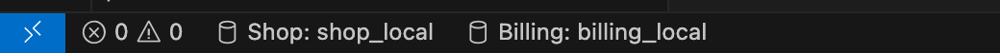
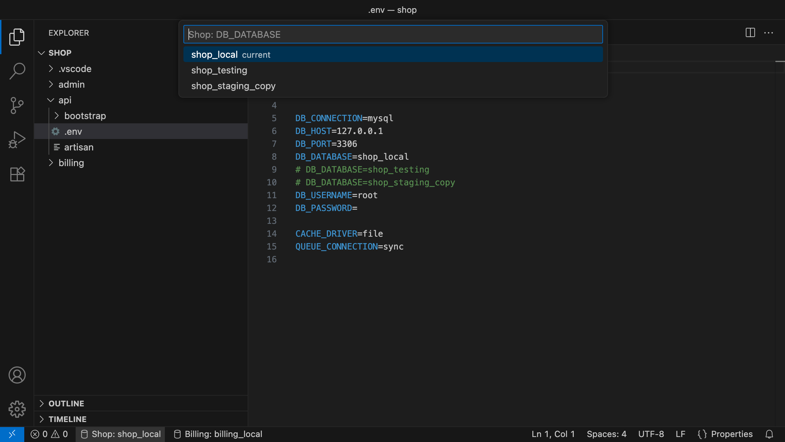
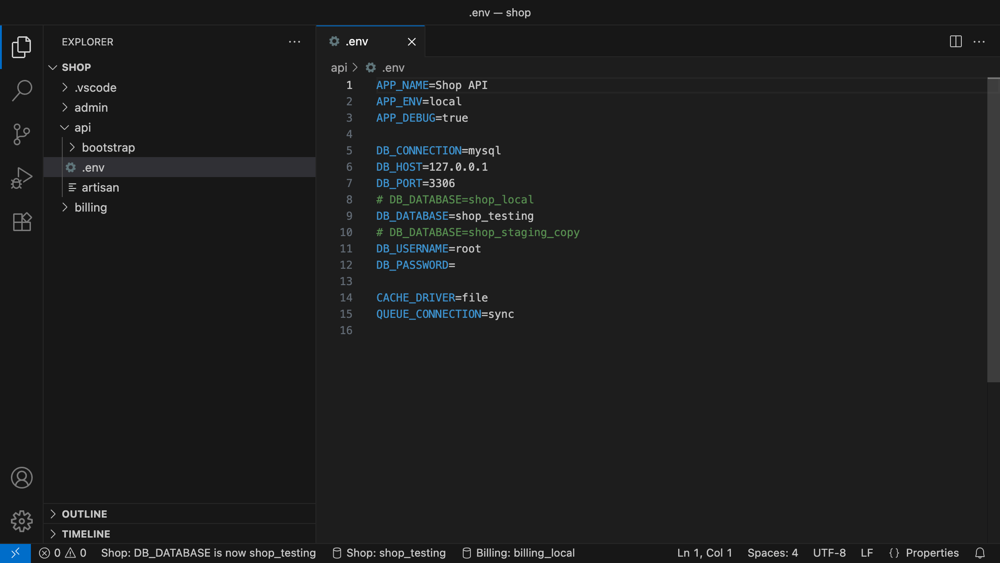
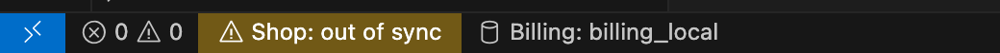

# Laravel Env Switcher

Switch a Laravel `.env` value, such as the database, from the VS Code status bar.

Most `.env` files already hold the alternatives as commented-out lines. This extension lists those lines as choices and does the commenting and uncommenting for you.



## How it works

Say your `.env` has this:

```dotenv
DB_DATABASE=shop_local
# DB_DATABASE=shop_testing
# DB_DATABASE=shop_staging_copy
```

1. The status bar shows the active value, `shop_local`.
2. Click it to see every value found in the file.

   

3. Pick one. The file is rewritten so only that line is active.

   

Nothing else in the file is touched. Lines are only commented or uncommented, never added or removed.

## Linked apps

Some projects are several Laravel apps that must point at the same database, for example an API and an admin app. Put them in a group and one click switches all of them.

Only values present in every linked `.env` are offered, so a switch never leaves one app behind.

If the files disagree, because someone edited one by hand, the label turns into a warning. Picking a value brings them back in line.



## Setup

With no settings, every Laravel app in the workspace gets its own switch. An app is any folder with both a `.env` and an `artisan` file, either the workspace folder itself or a folder directly inside it.

To link apps or switch other keys, add this to `.vscode/settings.json`:

```json
{
  "envSwitcher.keys": ["DB_DATABASE", "APP_ENV"],
  "envSwitcher.groups": [
    { "name": "Shop", "paths": ["api", "admin"] },
    { "name": "Billing", "paths": ["billing"] }
  ]
}
```

| Setting | Default | What it does |
|---|---|---|
| `envSwitcher.keys` | `["DB_DATABASE"]` | The keys you can switch. The first is shown in the status bar. With more than one, clicking asks which key first. |
| `envSwitcher.groups` | `[]` | Apps that switch together. `paths` are relative to the workspace folder. Once any group is set, only grouped apps are shown. |

## Good to know

- **Add a choice** by adding a commented line to the `.env`, for example `# DB_DATABASE=shop_demo`.
- **Config cache:** after a switch, `bootstrap/cache/config.php` is deleted if it exists, because Laravel ignores `.env` while that file is there. This is what `php artisan config:clear` does.
- **Long-running processes** such as queue workers or Octane keep the old value until you restart them.
- **One key at a time.** Switching a set of keys together, such as host, database and username, is not supported yet.

## Install

The extension is not on the Marketplace yet. Build it from source:

```bash
git clone https://github.com/octorber123/env-switcher.git
cd env-switcher
npx @vscode/vsce package
```

Then in VS Code run **Extensions: Install from VSIX...** from the Command Palette and choose the `.vsix` file that was created.

## Development

The file editing logic is in `lib/env.js` and has no VS Code dependency. Run its tests with:

```bash
npm test
```

## Licence

MIT. See [LICENSE](LICENSE).
